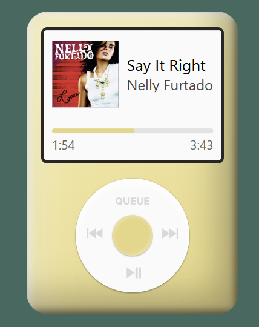

# Faux Player

A spotify widget that looks like an mp3 player.

## Features
- Play / pause / skip / previous track
- View and jump to songs in your queue
- Stays logged in between launches 
- Switch between different widget colours

## Just want to use it?
If a friend has added you to their Spotify app already, you don't need to set anything up, simply:

1. Download the latest build from the Releases page
2. **macOS users:** If macOS prevents the app from opening because it cannot verify the developer, you can try:
    > Settings > Privacy & Security > Open Anyway

    If that option is not available, you will need to remove the quarantine tag 
    > `xattr -rd com.apple.quarantine path/to/app`
    
    **Only do this for an application you downloaded from a source you trust**. Removing the quarantine attribute bypasses a macOS security check.

3. Open the app and log in with Spotify

## Want to run or fork this?
Spotify apps in Development Mode only allow **5 authorised users total** - so if you would like to share this with your own friends, you will need to set up your own Spotify app and build your own version.

1. Clone the repo
2. Create an app on [Spotify for Developers](https://developer.spotify.com/)
3. Copy your client ID and paste it into `CLIENT_ID` in `src/main/spotifyAuth.js`
4. In your Spotify app's settings, add `http://127.0.0.1:8888/callback` as a Redirect URI
5. Add your friends' Spotify accounts as authorised users in your app's dashboard settings
6. Run `npm install`, then `npm run dev` to test, or `npm run build:win` / `npm run build:mac` to produce distributable

## Tech Stack
- Electron + React
- Spotify Web API 
- OAuth Authorization Code flow with PKCE
- `safeStorage` for storing authentication data bewteen launches

## License
MIT